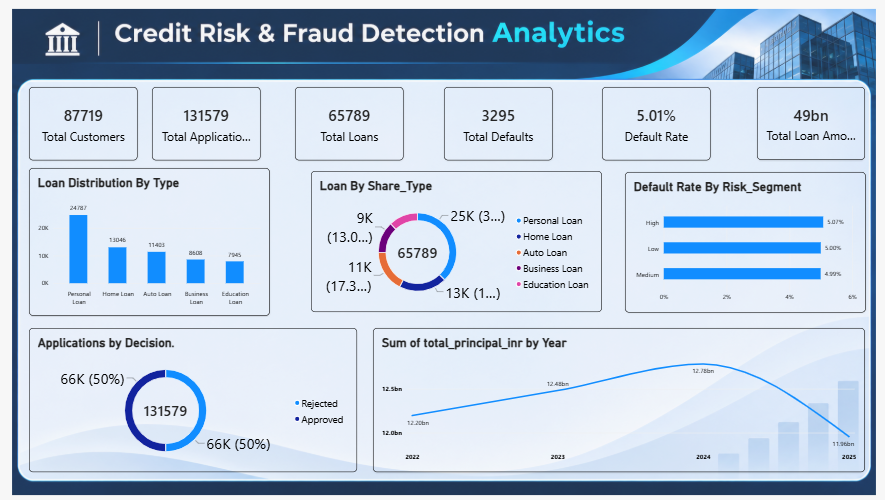
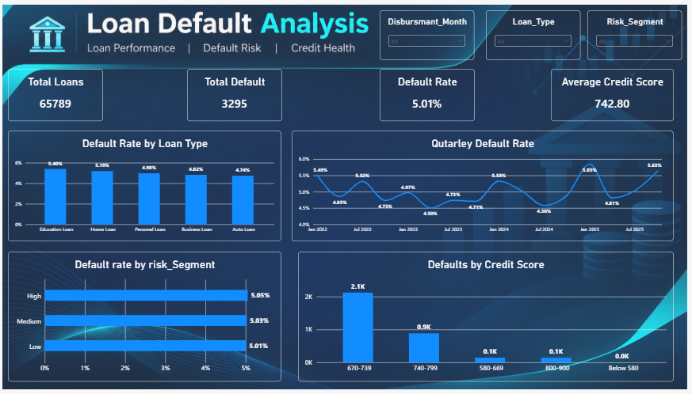
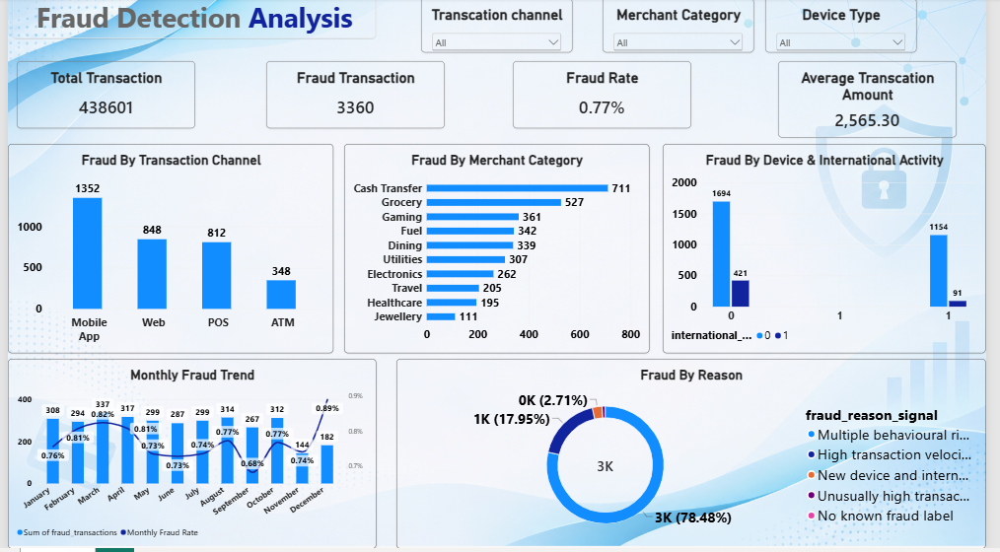
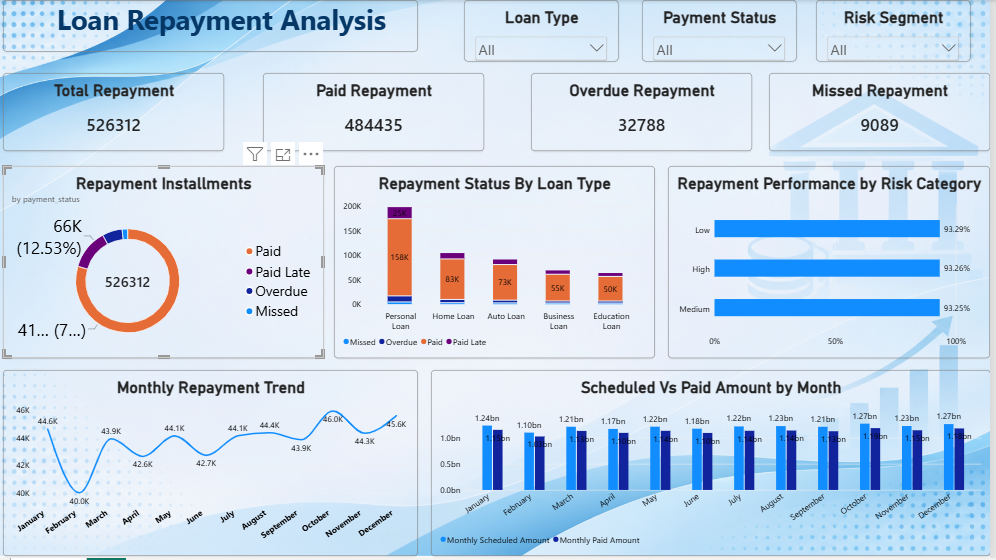

# Credit Risk & Fraud Detection Analytics

An end-to-end banking analytics portfolio project exploring credit risk, loan defaults, repayment performance, and transaction fraud indicators using Python, MySQL, and Power BI.

The project combines data preparation, quality validation, SQL business analysis, KPI development, and four Power BI reports across **1,250,000 synthetic records**.

> **Data disclaimer:** All records, identities, transactions, amounts, dates, and outcome labels are synthetic and created for learning and portfolio demonstration. They do not represent real customers, financial institutions, or verified fraud events.

---

## Project at a glance

| Area | Deliverable |
|---|---|
| Data | 5 related datasets; 1.25 million records |
| Python | Cleaning, validation, exploratory analysis, and analytical outputs |
| SQL | MySQL database setup, post-import checks, and 50 business analysis queries |
| Power BI | 4 reports covering overview, defaults, fraud, and repayments |
| Documentation | Data dictionary, validation report, key findings, DAX measures, and usage guides |

## Dashboard gallery

### 1. Credit Risk Overview

### 2. Loan Default Analysis

### 3. Fraud Detection Analysis

### 4. Loan Repayment Analysis

The editable Power BI files are in the [PowerBI folder](PowerBI/). Open the PBIX files with Power BI Desktop.

## Dataset inventory

| Dataset | Records | Columns |
|---|---:|---:|
| Customers | 87,719 | 9 |
| Loan applications | 131,579 | 11 |
| Loan accounts | 65,789 | 12 |
| Transactions | 438,601 | 13 |
| Loan repayments | 526,312 | 10 |
| **Total** | **1,250,000** | — |

The cleaned datasets are stored as compressed CSV files in [datasets/cleaned](datasets/cleaned/). The data dictionary and relationship overview are in [datasets/original](datasets/original/).

## Selected analytical results

| Metric | Result |
|---|---:|
| Total customers | 87,719 |
| Loan applications | 131,579 |
| Loan accounts | 65,789 |
| Defaulted loans | 3,295 |
| Overall default rate | 5.01% |
| Total loan principal | ₹49.42 billion |
| Transactions | 438,601 |
| Fraud-flagged transactions | 3,360 |
| Fraud-flag rate | 0.77% |
| Repayment installments | 526,312 |
| Net scheduled-versus-paid installment difference | ₹978.67 million |

These are results from the synthetic project data. The repayment difference is an installment-level scheduled-minus-paid measure; it is **not** a verified outstanding-principal balance. See [Key Findings](Documentation/Key_Findings.md) for interpretation and limitations.

## Analytical workflow

1. **Prepare and validate data** — inspect schema, nulls, duplicates, key uniqueness, relationships, date fields, and value ranges.
2. **Explore with Python** — perform EDA and calculate descriptive and risk-related summaries.
3. **Analyze with SQL** — create relational tables, validate imports, and answer business questions using 50 queries.
4. **Build Power BI reports** — present portfolio, default, fraud-indicator, and repayment KPIs.
5. **Document results** — record validation outcomes, findings, assumptions, and limitations.

## Repository structure

    Credit-Risk-Fraud-Detection-Analytics/
    ├── Dashboard_Previews/       # Four dashboard screenshots
    ├── Documentation/            # Validation report and key findings
    ├── PowerBI/                  # Four PBIX reports, DAX, KPI snapshot, guide
    ├── Python/                   # Analysis notebook, summary builder, and instructions
    ├── SQL/                      # Schema, validation, and 50 analysis queries
    ├── requirements.txt          # Python dependencies
    ├── datasets/
    │   ├── cleaned/              # Five compressed cleaned CSV datasets
    │   └── original/             # Data dictionary and source dataset notes
    ├── .gitattributes
    └── README.md

## Getting started

### 1. Read the project documentation

- [Python notebook and setup](Python/README.md)
- [SQL scripts and execution order](SQL/README.md)
- [Power BI reports and measures](PowerBI/README.md)
- [Data validation report](Documentation/Data_Validation.md)
- [Key findings and caveats](Documentation/Key_Findings.md)

### 2. Run the Python analysis

Install dependencies with `pip install -r requirements.txt`. The full exploratory notebook loads the five datasets together; use Google Colab or a machine with sufficient memory for the complete notebook. For low-memory computers, use the summary builder (`python Python/build_powerbi_summaries.py`), which processes one source dataset at a time.

### 3. Load the cleaned data

The files in datasets/cleaned are gzip-compressed CSVs. Pandas can read them directly:

    import pandas as pd
    customers = pd.read_csv("../datasets/cleaned/customers_cleaned.csv.gz")

For large tables on a low-memory computer, read only required columns or use chunked loading.

## Important limitations

- The data and labels are synthetic; results are not suitable for real credit decisions, lending, compliance, or fraud investigations.
- Fraud reason fields are illustrative signals, not verified causal explanations.
- The transaction table is not a complete bank ledger and must not be used to infer account balances.
- The repayment data does not contain a reliable actual payment-date field; payment status and lateness labels cannot be independently audited against payment timestamps.
- Repayment outcomes occur after loan origination. Using them as features to predict default at application time would cause target leakage.
- Power BI reports use aggregated summary data to keep the model workable on a low-memory laptop; this limits row-level drill-through and arbitrary detail analysis.

## Tools

Python, pandas, NumPy, Matplotlib, Seaborn, MySQL 8.0, Microsoft Power BI Desktop, DAX, Jupyter Notebook, and Google Colab.
